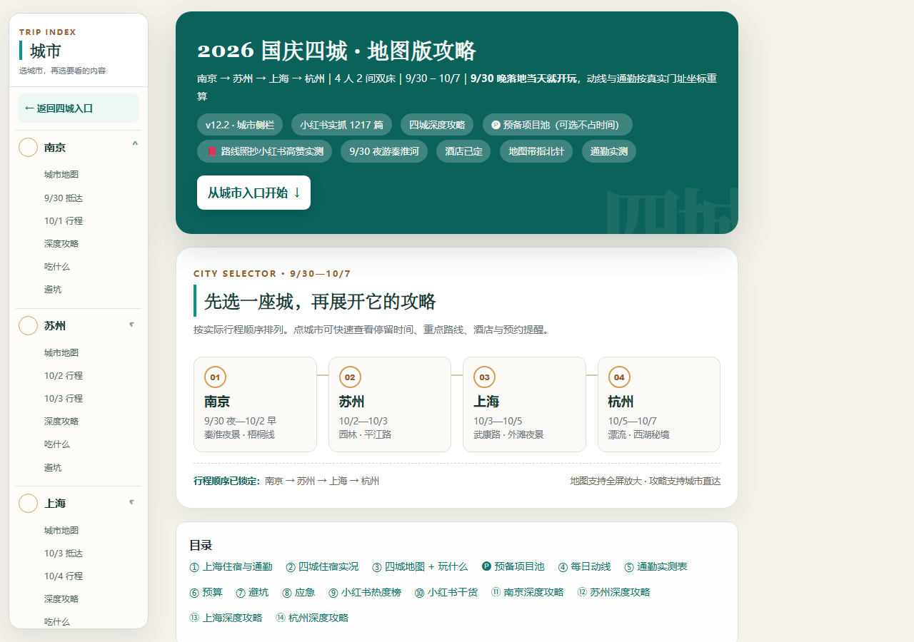

# 2026 国庆江南四城旅行攻略

一份面向手机阅读的南京、苏州、上海、杭州四城旅行攻略。页面按实际行程顺序组织，集中收录交通缓冲、每日动线、手绘关系地图、景点与美食、预约项目和避坑提醒。

**在线阅读：** <https://shihao29.github.io/jiangnan-four-city-guide-2026/>



## 页面特点

- 南京 → 苏州 → 上海 → 杭州，按旅行日期串联。
- 桌面端常驻城市侧栏，手机端使用抽屉目录。
- 可直达每座城市的地图、当日行程、深度攻略、美食和避坑内容。
- 长篇说明、资料来源和注意事项可折叠，保留详细内容的同时减轻手机端阅读压力。
- 四张城市关系地图使用内联 SVG，页面不依赖外部资源，下载后可离线打开。

## 本地打开

直接双击 `index.html`，或在当前目录启动任意静态文件服务器。例如：

```bash
python -m http.server 8000
```

然后访问 <http://localhost:8000/>。

## 仓库结构

```text
.
├── index.html     # 完整交互攻略
├── preview.png   # 项目预览图
├── README.md     # 项目说明
└── .nojekyll     # GitHub Pages 静态文件标记
```

## 说明

这份攻略使用的车次、开放时间、票价和预约规则以 2026 年国庆行程为基准。将来复用时，请在出发前再核对官方信息。
